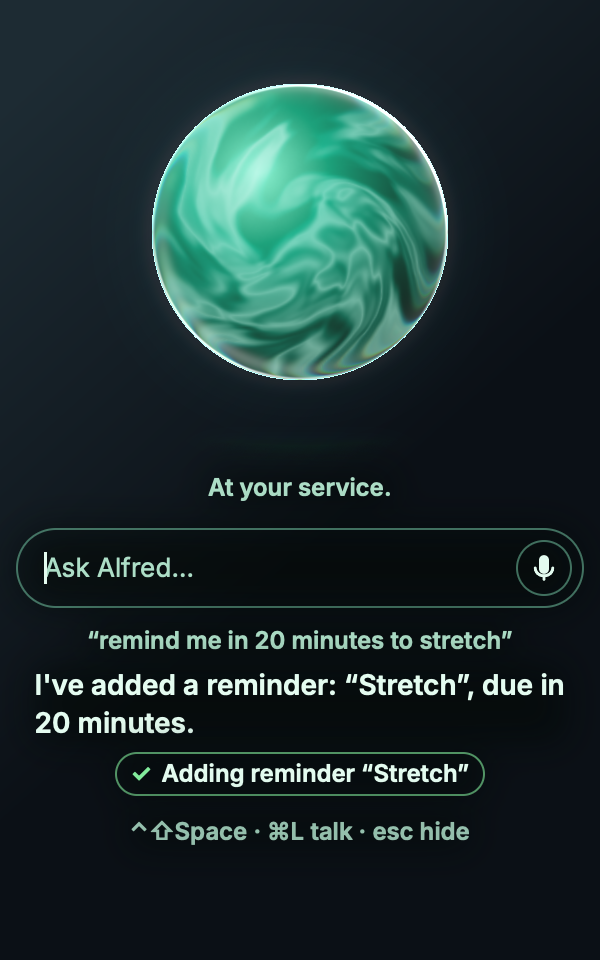

<p align="center">
  
</p>

<h1 align="center">Alfred</h1>

<p align="center"><strong>A local, voice-first assistant for your Mac.</strong><br>
Summon it, say or type what you need, and it opens your apps, saves notes, adds reminders and searches the web: on your Mac, with a tiny model, in a calm British voice.</p>

<p align="center">
  
</p>

## What it does

- **Summon it anywhere.** Press <kbd>⌃⌥Space</kbd> and the panel drops in at the top of the screen you're on. <kbd>esc</kbd> hides it.
- **Talk or type.** Click the orb (or <kbd>⌘L</kbd>) and speak; Alfred stops listening when you do.
- **It does things.** Opens and quits apps, saves notes in Notes, adds reminders, searches Google, opens links, tells the time.
- **It reads your mail and drafts replies.** "Read my last email", "reply to it saying I'll be there at 3": the reply opens in Mail for you to check and send. Alfred never sends mail.
- **It runs your Shortcuts.** "Run Good Morning", or just "start the vacuum" when you have a shortcut for it.
- **It can use other apps on screen.** With [agent-desktop](https://github.com/vercel-labs/agent-desktop) installed, Alfred can operate apps that have no shortcut, such as Slack or WhatsApp.
- **It talks back.** Every answer is spoken with Kokoro, sentence by sentence, while the orb ripples with the voice.
- **Everything stays on your Mac.** The language model runs in Ollama, speech and dictation run in-process. No account, no cloud.
- **Safe by default.** No shell, no arbitrary scripts. Quitting an app, a shortcut Alfred picked for you, and any Send, Delete or Pay click wait for your yes.

Try:

```text
open Notes and save pick up the dry cleaning
search Google for the Rune UI framework
remind me in 20 minutes to stretch
open Safari and search for train times to Bath
read my last email
reply to my last email from Ada saying see you Friday
quit Music
```

## Get started

You need an Apple-silicon Mac, [Rust](https://rustup.rs), and [Ollama](https://ollama.com).

```bash
brew install ollama
```

```bash
ollama serve
```

In another terminal:

```bash
git clone https://github.com/laurentlouk/alfred.git && cd alfred
```

```bash
cargo run --release -- setup
```

`setup` writes the config, downloads the voice (Kokoro-82M, 126 MB) and dictation (Moonshine tiny, 28 MB) models, and pulls the language model (`qwen3:0.6b`, about 520 MB). Then build and install the app:

```bash
scripts/bundle-macos.sh --install
```

That puts `Alfred.app` in `~/Applications` and opens it. The first time Alfred saves a note, adds a reminder or reads your mail, macOS asks whether Alfred may control Notes, Reminders or Mail; the first time you talk, it asks for the microphone.

## The command line

The same brain runs headless, which is handy for scripts and for trying things out. Put `alfred` on your `PATH` first:

```bash
cargo install --path apps/alfred
```

```bash
alfred ask "open Notes and save buy oat milk"
```

| Command | What it does |
| --- | --- |
| `alfred` | Open Alfred |
| `alfred ask TEXT` | Do what TEXT asks. `--dry-run` shows the action instead, `--yes` confirms, `--speak` says the answer |
| `alfred say TEXT` | Speak with Alfred's voice |
| `alfred listen FILE.wav` | Transcribe a recording |
| `alfred setup` | Write the config, download the models, pull the language model |
| `alfred doctor` | Check what is ready and what is missing |
| `alfred shortcuts` | List the Shortcuts Alfred can run |
| `alfred eval [--model]` | Score Alfred on the request fixture in `eval/utterances.toml` |

## How it works

```text
 you ──► Rune panel ──► router ──── recognized ───► action ──► Notes · Reminders · Mail · browser · apps
  ▲        (orb, field)    │                          ▲
  │                        └─ not recognized ─► small model ─(schema-constrained decision)─┘
  │
  └──── Kokoro voice ◄── reply                 Moonshine ◄── microphone
```

1. **The router** turns everyday phrasings into actions instantly, with no model at all: "open …", "save a note …", "remind me in … to …", "search Google for …", "what time is it". It errs on the side of passing a request on: a wrong action is worse than a slower right one.
2. **The model** handles everything else. A 0.6B model picks the right tool but mangles its arguments, so Alfred asks it for a JSON decision under a schema whose `action` is an enum of the tools (Ollama's structured outputs). It cannot answer with prose where a tool belongs or invent a tool. Arguments are then repaired (a string sent as an object, a renamed field) and fields the user never said (a reminder delay) are dropped.
3. **Actions** run through `open` and `osascript`. Every AppleScript is a constant that reads its inputs from `on run argv`, so whatever you dictate is text, never code. Links must be `http(s)`. Quitting an app needs a yes.
4. **Answers** come from what the actions did ("I've saved a note: “Buy oat milk”."), not from the model's summary of it, which saves a second model call and keeps a small model honest.

### Measured

`alfred eval --model` on the 46 requests in [`eval/utterances.toml`](eval/utterances.toml), with `qwen3:0.6b` on an M1 Max:

| Path | Share of requests | Correct | Time |
| --- | --- | --- | --- |
| Router | 59% (27 of 46) | 100% | under 1 ms |
| Model, structured decisions | 41% (19 of 46) | 79% | 0.1 to 0.3 s |
| **Overall** | | **91%** | |

Native tool calls, measured on the earlier 40 requests for comparison, got 47% of the model's share right against 82% for structured decisions.

A bigger model follows looser requests better. With `qwen3:4b` the same fixture scores 96%: it also gets the loose mail requests ("has anyone emailed me this morning?", "tell whoever wrote to me last that I got it") that `qwen3:0.6b` answers with chat. Set `model = "qwen3:4b"` in the config and run `ollama pull` for it.

## Reaching other apps

**Mail.** "Read my last email", "who emailed me last", "anything new in my inbox?" and "lis mon dernier mail" read the newest email in your inbox: who sent it, when, the subject and how it begins. Name a sender ("the last email from Ada") to read theirs. "Reply to my last email saying …" (or "réponds au dernier mail de Marie en disant …") opens a reply in Mail with your words in it, brought forward for you to check and send. Without words, Alfred asks what to say. Alfred has no way to send mail: the script it runs contains no send command, and a test keeps it that way. What an email says is spoken to you but never kept in the conversation the model sees, so an email can't give Alfred orders.

**Shortcuts.** Every shortcut in your Shortcuts app is available. Name one ("run Good Morning", "run the Lights Off shortcut") and it runs at once. Say it more loosely ("I'm cold in the living room") and the model picks the shortcut, then asks before running it, because shortcuts drive real devices. Names you trust can skip the question: list them in `[shortcuts] trusted`. `alfred shortcuts` shows them all.

**On screen.** For apps with no shortcut, Alfred can operate the app itself through its accessibility tree:

```bash
brew install agent-desktop
```

Then allow Alfred in System Settings → Privacy & Security → Accessibility (or your terminal, for the command line). Alfred looks at the app's window, picks one step, acts, and looks again, at most 8 steps. It works only inside the app you named, it never moves your pointer, and it stops before anything irreversible: a Send, Delete, Pay or Publish click comes back to you as a Yes/No question. Text inside the app, like an email, is treated as content, never as instructions. Reading an app's interface needs a bigger model than the default, set in `[desktop] model` (`qwen3:8b` by default):

```bash
ollama pull qwen3:8b
```

Tested live in Mail: `qwen3:4b` answers questions about what's on screen (who sent the latest email) but loses its place in multi-step tasks; `qwen3:8b` plans and follows menu commands (select a message, Reply). Mail's message body is a web view that can't be filled without physical keystrokes, which Alfred never sends, so Mail has its own tools (above).

Measured with `alfred eval --model eval/apps.toml` (15 requests: named and loose shortcuts, on-screen tasks):

| Main model | Loose requests right | Overall | Time per decision |
| --- | --- | --- | --- |
| `qwen3:0.6b` | 1 of 11 | 33% | about 0.2 s |
| `qwen3:4b` | 10 of 11 | 93% | 0.5 to 1 s |

Named shortcuts go through the router and work with any model. For loose requests to your apps, set `[llm] model = "qwen3:4b"`.

## Configuration

`~/Library/Application Support/Alfred/config.toml` (`ALFRED_HOME` moves the folder). Every field has a default:

```toml
[llm]
provider = "ollama"          # or "openai" for llama-server, LM Studio, mlx-lm…
tool_mode = "structured"     # or "native" for larger models
base_url = "http://127.0.0.1:11434"
model = "qwen3:0.6b"

[voice]
speak = true
voice = "bm_george"          # British male; try bf_emma, af_heart, am_michael
speed = 1.05

[ui]
shortcut = "ctrl+alt+space"
hide_on_blur = true

[search]
engine = "google"            # duckduckgo, bing
browser = ""                 # empty for your default browser, or "Safari"

[shortcuts]
enabled = true
trusted = []                 # shortcut names that run without asking when Alfred picks them

[desktop]
enabled = true               # on-screen actions, when agent-desktop is installed
model = "qwen3:8b"           # the model that reads app windows
max_steps = 8
```

## Develop

```bash
cargo test --workspace
```

The suite covers the router, argument repair, the agent loop (against a scripted model), the macOS actions (including an injection attempt that must come back as plain text), the UI (in Rune's headless runtime), and a Kokoro → Moonshine round trip when the models are downloaded.

The panel renders headlessly, which is how the images in this README were made:

```bash
cargo run -p alfred -- --snap docs/images/conversation.png --scene conversation --scale 2
```

Scenes: `idle`, `listening`, `thinking`, `speaking`, `conversation`, `confirm`.

| Crate | What it holds |
| --- | --- |
| [`crates/alfred-core`](crates/alfred-core) | Router, tools and argument repair, the agent loop, the LLM clients, config, eval. No UI, no native code |
| [`crates/alfred-mac`](crates/alfred-mac) | The macOS executor: apps, Notes, Reminders, browser |
| [`crates/alfred-voice`](crates/alfred-voice) | Kokoro speech and Moonshine dictation, model downloads |
| [`crates/alfred-hands`](crates/alfred-hands) | Operating apps on screen with agent-desktop: the observe-decide-act loop and its guard |
| [`apps/alfred`](apps/alfred) | The Rune app and the `alfred` command line |

Design notes live in [`docs/specs`](docs/specs).

## Built with

- [Rune](https://github.com/anomalyco/rune), a GPU-rendered Rust UI framework (MIT)
- [sherpa-onnx](https://github.com/k2-fsa/sherpa-onnx) for on-device speech (Apache-2.0)
- [Kokoro-82M](https://huggingface.co/hexgrad/Kokoro-82M) voice (Apache-2.0), phonemized by [misaki-rs](https://github.com/MicheleYin/misaki-rs) (MIT)
- [Moonshine](https://github.com/moonshine-ai/moonshine) tiny for dictation (MIT)
- [Ollama](https://ollama.com) and [Qwen3](https://huggingface.co/Qwen) (Apache-2.0)
- [agent-desktop](https://github.com/vercel-labs/agent-desktop) for on-screen actions, optional (Apache-2.0)

No GPL code is linked: Kokoro's phonemes come from misaki-rs rather than espeak-ng.

## License

[MIT](LICENSE)
