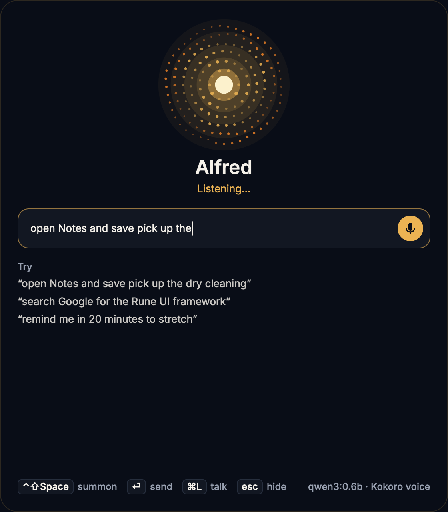

<p align="center">
  
</p>

<h1 align="center">Alfred</h1>

<p align="center"><strong>A local, voice-first assistant for your Mac.</strong><br>
Summon it, say or type what you need, and it opens your apps, saves notes, adds reminders and searches the web: on your Mac, with a local model, in a calm British voice.</p>

<p align="center">
  
</p>

## What it does

- **Always at hand.** Alfred is an orb that floats over your windows, on your main display and on every desktop, with no window or background around it; drag the orb to put it anywhere. <kbd>⌃⇧Space</kbd> brings it forward, it's in the Dock and <kbd>⌘Tab</kbd> like any app, and <kbd>esc</kbd> puts it away. Answers are spoken rather than written, and the field grows as you type, like a chat's (<kbd>Return</kbd> sends, <kbd>⇧Return</kbd> adds a line).
- **Just say "Alfred".** "Alfred, what time is it?" works from across the room, like "Hey Siri" (turn on `wake_word`); the mic button turns that listening off, and the microphone with it, and back on. Or press <kbd>⌘L</kbd> and speak. Your words appear as you say them, background noise is cleaned out, and Alfred answers about half a second after you stop. Say "Alfred" while it talks to cut it short.
- **A conversation, not commands.** After Alfred answers something you said, it keeps listening for 30 seconds: say the next thing without "Alfred", and each exchange starts the 30 seconds again. "Alfred, stop" ends it. While Alfred is talking, only "Alfred" interrupts.
- **It does things.** Opens and quits apps, saves notes in Notes, adds reminders, searches the web, opens links, tells the time.
- **It answers from the web.** "What's the weather in Paris?" opens the results in Alfred's own browser tab, reads them, and tells you; when they don't say, it keeps looking, as you would.
- **It knows where you are.** Alfred sees which app you're in and, in a browser, which site, so "this page", "here" and follow-ups just work: "go to the Pokémon website", then "what Pokémon do you see?", then "open the Pokédex and tell me the first one". "Prompt Claude for me: …" writes it in Claude.
- **It thinks when it has to.** "Good evening" is answered at once; "I save 150 euros a month, when do I reach 2,000?" is thought through first.
- **It reads your mail and drafts replies.** "Read my last email", "reply to it saying I'll be there at 3": the reply opens in Mail for you to check and send. Alfred never sends mail.
- **It runs your Shortcuts.** "Run Good Morning", or just "start the vacuum" when you have a shortcut for it.
- **It can use other apps on screen.** With [agent-desktop](https://github.com/vercel-labs/agent-desktop) installed, Alfred can operate apps that have no shortcut, such as Slack or WhatsApp.
- **It talks back.** Every answer is spoken with Kokoro, sentence by sentence, at your Mac's volume, while the orb pulses with the voice.
- **Everything stays on your Mac.** The language model runs in Ollama, speech and dictation run in-process. No account, no cloud.
- **Safe by default.** No shell, no arbitrary scripts. Quitting an app, a shortcut Alfred picked for you, and any Send, Delete or Pay click wait for your yes.

Try:

```text
open Notes and save pick up the dry cleaning
search Google for the Rune UI framework
remind me in 20 minutes to stretch
open Safari and search for train times to Bath
read my last email
reply to my last email from Ada saying see you Friday
quit Music
```

## Get started

You need an Apple-silicon Mac, [Rust](https://rustup.rs), and [Ollama](https://ollama.com).

```bash
brew install ollama
```

```bash
ollama serve
```

In another terminal:

```bash
git clone https://github.com/laurentlouk/alfred.git && cd alfred
```

```bash
cargo run --release -- setup
```

`setup` writes the config, downloads the voice (Kokoro-82M, 350 MB), dictation (Moonshine tiny, 28 MB) and listening models (the "Alfred" keyword spotter, voice detection and noise cleaning, about 20 MB), and pulls the language model (`qwen3:0.6b`, about 520 MB, which runs on any Apple-silicon Mac; see [Choosing a model](#choosing-a-model) for a better one). Then build and install the app:

```bash
scripts/bundle-macos.sh --install
```

That puts `Alfred.app` in `~/Applications` (quitting a running Alfred first) and opens it. The first time Alfred saves a note, adds a reminder or reads your mail, macOS asks whether Alfred may control Notes, Reminders or Mail; the first time you talk, it asks for the microphone. With agent-desktop installed, Alfred asks for Accessibility at launch, the way other Mac apps do, and opens System Settings at Privacy & Security → Accessibility so turning it on is one click.

macOS remembers these permissions by the app's signature. The script signs with your "Apple Development" certificate when you have one (or the identity in `ALFRED_SIGN`), so permissions survive rebuilds; an ad hoc signature changes with every build, and macOS then asks again.

## The command line

The same brain runs headless, which is handy for scripts and for trying things out. Put `alfred` on your `PATH` first:

```bash
cargo install --path apps/alfred
```

```bash
alfred ask "open Notes and save buy oat milk"
```

| Command | What it does |
| --- | --- |
| `alfred` | Open Alfred |
| `alfred ask TEXT` | Do what TEXT asks. `--dry-run` shows the action instead, `--yes` confirms, `--speak` says the answer |
| `alfred chat` | A conversation: one request per line, typed or piped in, each knowing the ones before it |
| `alfred say TEXT` | Speak with Alfred's voice |
| `alfred listen FILE.wav` | Transcribe a recording |
| `alfred setup` | Write the config, download the models, pull the language model |
| `alfred doctor` | Check what is ready and what is missing |
| `alfred shortcuts` | List the Shortcuts Alfred can run |
| `alfred eval [--model]` | Score Alfred on the request fixture in `eval/utterances.toml` |

## How it works

```text
 microphone ─► "Alfred"? ─► noise cleaning ─► voice detection ─► Moonshine ─┐
                                                                            ▼
 you ──► orb and field ──► router ──── recognized ───► action ──► Notes · Reminders · Mail · browser · apps
  ▲                          │                           ▲
  │                          └─ not recognized ─► model ─┘   (hard question? think it through first)
  │
  └──── Kokoro voice ◄── reply
```

1. **Listening** runs on one microphone stream. A keyword spotter waits for "Alfred"; then the audio is cleaned of steady noise, a voice detector (Silero) decides where speech ends, and Moonshine writes it down as you speak. The detector learns the room's noise between words, and a voice much quieter than yours (someone across the room) neither starts nor prolongs a command. A finished sentence ends after 0.6 s of quiet, one that trails off ("open Notes and…") after 1.2 s.
2. **The router** turns everyday phrasings into actions instantly, with no model at all: "open …", "save a note …", "remind me in … to …", "search Google for …", "what time is it". It errs on the side of passing a request on: a wrong action is worse than a slower right one.
3. **The model** handles everything else. A 0.6B model picks the right tool but mangles its arguments, so Alfred asks it for a JSON decision under a schema whose `action` is an enum of the tools (Ollama's structured outputs). It cannot answer with prose where a tool belongs or invent a tool. Arguments are then repaired (a string sent as an object, a renamed field) and fields the user never said (a reminder delay) are dropped.
4. **Actions** run through `open` and `osascript`. Every AppleScript is a constant that reads its inputs from `on run argv`, so whatever you dictate is text, never code. Links must be `http(s)`. Quitting an app needs a yes.
5. **Answers** come from what the actions did ("I've saved a note: “Buy oat milk”."), not from the model's summary of it, which saves a second model call and keeps a small model honest.
6. **Hard questions** are thought through. The model flags a question that needs working out (or the words plainly ask for it: sums, percentages, "step by step"), and Alfred asks again with thinking on, optionally of a second model (`think_model`). Actions never think.

### Measured

`alfred eval --model` on the 46 requests in [`eval/utterances.toml`](eval/utterances.toml), with `qwen3:0.6b` on an M1 Max:

| Path | Share of requests | Correct | Time |
| --- | --- | --- | --- |
| Router | 59% (27 of 46) | 100% | under 1 ms |
| Model, structured decisions | 41% (19 of 46) | 79% | 0.1 to 0.3 s |
| **Overall** | | **91%** | |

Native tool calls, measured on the earlier 40 requests for comparison, got 47% of the model's share right against 82% for structured decisions.

A bigger model follows looser requests better. With `qwen3:4b` the same fixture scores 96%: it also gets the loose mail requests ("has anyone emailed me this morning?", "tell whoever wrote to me last that I got it") that `qwen3:0.6b` answers with chat.

### Choosing a model

The default runs on any Apple-silicon Mac. With more memory, Gemma 4 does much better. Measured on an M1 Max with 64 GB:

| | `gemma4:e4b` (9.5 GB) | `gemma4:26b` (16 GB) |
| --- | --- | --- |
| Requests ([`eval/utterances.toml`](eval/utterances.toml), 51) | 92% | 96% |
| Apps and shortcuts ([`eval/apps.toml`](eval/apps.toml), 21) | 76% | 95% |
| Hard questions ([`eval/thinking.toml`](eval/thinking.toml), 11) | 100%, 8 s each | 91%, 51 s each |
| Quick answer | 0.3 to 0.5 s | 0.5 to 0.8 s |

`26b` picks the right action more often but thinks slowly; `e4b` thinks fast. With 32 GB or more, use both: `26b` decides and `e4b` thinks hard questions through. Together they got all 11 hard questions right at 6.4 s each, with quick answers at 0.5 s.

```bash
ollama pull gemma4:26b
```

```bash
ollama pull gemma4:e4b
```

```toml
[llm]
model = "gemma4:26b"
tool_mode = "native"
think_model = "gemma4:e4b"
```

Ollama's Apple-silicon builds of Gemma can't do structured output; Alfred notices and uses native tool calls anyway, and `tool_mode = "native"` skips that first try. Operating apps and websites needs structured output, so keep `qwen3:8b` there (`[desktop] model`): Gemma's 8-bit build that has it finished 1 of 3 live Wikipedia tasks, against 3 of 3 for `qwen3:8b`. On a Mac with less memory, `gemma4:e4b` alone (no `think_model`) needs about 10 GB, and `qwen3:4b` (2.5 GB) is a smaller step up from the default. `qwen3.5:35b` decides a little less well than `gemma4:26b` (94% and 90% against 96% and 95%) and thinks far more slowly (34 s a question).

**One model for deciding and for driving apps and pages.** Ollama's default `qwen3.5:35b` on Apple silicon can't follow a schema, but the standard build of the same model can:

```bash
ollama pull qwen3.5:35b-a3b-q4_K_M
```

```toml
[llm]
model = "qwen3.5:35b-a3b-q4_K_M"
tool_mode = "native"
context_tokens = 16384       # the same as the steps use, so Ollama never reloads the model between them
think_model = "gemma4:e4b"

[desktop]
model = "qwen3.5:35b-a3b-q4_K_M"
```

Measured on an M1 Max with 64 GB: three live Wikipedia tasks answered in 38 to 45 s each, where `qwen3:8b` answered one and ran out of steps on the other two (139 and 152 s); 92% of requests, 95% of app requests, 11 of 11 hard questions. A quick answer takes about 1.2 s, against 0.6 s for the Apple-silicon build. Two 22 GB builds don't stay loaded together (Ollama unloads one, and loading it again takes 10 to 20 s), so use one build for both jobs.

## Reaching other apps

**Mail.** "Read my last email", "who emailed me last", "anything new in my inbox?" and "lis mon dernier mail" read the newest email in your inbox: who sent it, when, the subject and how it begins. Name a sender ("the last email from Ada") to read theirs. "Reply to my last email saying …" (or "réponds au dernier mail de Marie en disant …") opens a reply in Mail with your words in it and the email quoted below, brought forward for you to check and send. Without words, Alfred asks what to say. Alfred has no way to send mail: the script it runs contains no send command, and a test keeps it that way. What an email says is spoken to you but never kept in the conversation the model sees, so an email can't give Alfred orders.

**Shortcuts.** Every shortcut in your Shortcuts app is available. Name one ("run Good Morning", "run the Lights Off shortcut") and it runs at once. Say it more loosely ("I'm cold in the living room") and the model picks the shortcut, then asks before running it, because shortcuts drive real devices. Names you trust can skip the question: list them in `[shortcuts] trusted`. `alfred shortcuts` shows them all.

**On screen.** For apps with no shortcut, Alfred can operate the app itself through its accessibility tree:

```bash
brew install agent-desktop
```

Alfred then asks for Accessibility and opens System Settings at Privacy & Security → Accessibility: turn on Alfred (or your terminal, for the command line). When you ask to be told something ("read my latest WhatsApp message", "how many conversations are there?"), Alfred first reads the window as it is and answers in one look, a few seconds, when it already shows the answer. Otherwise it looks at the window, picks one step, acts, and looks again, at most 8 steps. It names the places most apps share (a chat's message box, its search field, its send button) for the model, so it goes straight to them.

**Messages.** "Send Ada a WhatsApp saying see you at 7", "reply to my latest WhatsApp message saying on my way", "text Marie in Messages: I'm running late" or "ask Claude what the capital of Italy is" follow the recipe every chat app shares, with no model step at all: open the conversation (its row, through search when it isn't listed, the newest one for a reply), type into the message box, and ask you before clicking Send. It takes a few seconds; when a step can't be found, Alfred falls back to working step by step. A conversation is opened only for a name you said. It works only inside the app you named, it never moves your pointer, and it stops before anything irreversible: a Send, Delete, Pay or Publish click comes back to you as a Yes/No question. Text inside the app, like an email, is treated as content, never as instructions. Reading an app's interface needs a bigger model than the default, set in `[desktop] model` (`qwen3:8b` by default):

```bash
ollama pull qwen3:8b
```

Tested live in Mail: `qwen3:4b` answers questions about what's on screen (who sent the latest email) but loses its place in multi-step tasks; `qwen3:8b` plans and follows menu commands (select a message, Reply). Mail's message body is a web view that can't be filled without physical keystrokes, which Alfred never sends, so Mail has its own tools (above).

Measured with `alfred eval --model eval/apps.toml` (15 requests: named and loose shortcuts, on-screen tasks):

| Main model | Loose requests right | Overall | Time per decision |
| --- | --- | --- | --- |
| `qwen3:0.6b` | 1 of 11 | 33% | about 0.2 s |
| `qwen3:4b` | 10 of 11 | 93% | 0.5 to 1 s |

Named shortcuts go through the router and work with any model. For loose requests to your apps, set `[llm] model = "qwen3:4b"`.

**On the web.** With [agent-browser](https://github.com/vercel-labs/agent-browser) installed, Alfred has its own Chrome window, with its own profile (`~/Library/Application Support/Alfred/browser`, never your Chrome profiles):

```bash
brew install agent-browser
```

A question that needs the web ("what's the weather in Paris", "who won the last Champions League final") opens the search results in that window, and Alfred reads them and answers in a sentence, saying where the answer came from. A task that takes a few steps on a site ("on amazon.fr, find the price of the Kindle Paperwhite", "compare the AirPods Pro on apple.com and fnac.com") runs the same look-decide-act loop as on screen, at most 10 steps, with the model from `[desktop] model`. Alfred only opens an address you said; it follows links on the page, goes back or searches, but never opens an address it read on a page. It never types passwords, card numbers or sign-in codes, and a Place order, Book, Subscribe or Sign up click comes back to you as a Yes/No question. Cookie walls are declined ("Reject all"); a robot check is left for you to answer in the window. The window stays open on the last page so you can see it and take over.

Sites you ask Alfred to open ("open gmail.com") open in that window too, so it can look at them when you ask a follow-up; sign in there once and it remembers. A page you're looking at in your own browser ("what's this page about?") opens in Alfred's window at the same address.

**In your own Chrome.** Already signed in everywhere in Chrome? Set `[browser] use_chrome = true` and Alfred works in your Chrome instead, in a tab of its own labelled for it, where the sites you ask for open, so follow-ups can look at them. In Chrome, a request about the page you're on ("what's this page about?", "open the second story", "add this to my cart", "scroll down") works in that tab, with agent-browser; Alfred never reads, navigates or clicks your other tabs. Chrome lets it in once you turn on remote debugging at `chrome://inspect/#remote-debugging` (Chrome 144 or later), asks you to allow Alfred when it connects, and shows a banner while it does. Signed in, Alfred acts as you, so a Reply, Share, Invite, Authorize or Follow click waits for your yes too, as do the clicks above.

## Configuration

`~/Library/Application Support/Alfred/config.toml` (`ALFRED_HOME` moves the folder). Every field has a default:

```toml
[llm]
provider = "ollama"          # or "openai" for llama-server, LM Studio, mlx-lm…
tool_mode = "structured"     # or "native" for larger models
base_url = "http://127.0.0.1:11434"
model = "qwen3:0.6b"
thinking = "auto"            # think hard questions through; "never" or "always"
think_tokens = 2048          # room for a thought-through answer
keep_alive = "4h"            # how long Ollama keeps the model loaded; Alfred warms it at launch
# think_model = "gemma4:e4b" # another model for the thinking (unset: `model` thinks)

[voice]
speak = true
voice = "bm_george"          # British male; try bf_emma, af_heart, am_michael
speed = 1.05
wake_word = false            # true: keep the microphone open and listen for "Alfred"
follow_up_secs = 30.0        # after a spoken answer, keep listening this long without "Alfred" (0: off)
silence_secs = 1.2           # quiet that ends a command that trails off
max_listen_secs = 20.0

[ui]
shortcut = "ctrl+shift+space"   # macOS keeps ⌃Space and ⌃⌥Space for switching keyboards
hide_on_blur = false        # true: put the panel away when another app comes forward

[search]
engine = "google"            # duckduckgo, bing
browser = ""                 # empty for your default browser, or "Safari"

[shortcuts]
enabled = true
trusted = []                 # shortcut names that run without asking when Alfred picks them

[desktop]
enabled = true               # on-screen actions, when agent-desktop is installed
model = "qwen3:8b"           # the model that reads app windows and web pages
max_steps = 8

[recording]
enabled = false              # true: keep what Alfred saw, decided and did, on this Mac only (see below)
max_mb = 500                 # recording stops when the folder reaches this size

[browser]
enabled = true               # website tasks and spoken search answers, when agent-browser is installed
command = "agent-browser"
profile = "~/Library/Application Support/Alfred/browser"   # Alfred's own Chrome profile
headed = true                # show the window, so you can watch and step in
use_chrome = false           # true: work in your own Chrome, in a tab of its own
max_steps = 10
```

## Recording, to teach Alfred later

Alfred can keep a record of its own runs, so it can be taught from them: fixed recipes for what you do often, examples from your own requests, or fine-tuning a small model. It is off unless you turn it on:

```toml
[recording]
enabled = true
```

While it is on, the footer shows `● rec`, and `~/Library/Application Support/Alfred/recordings` gets one file a day that only you can read. Each line is one record: a request and its answer, a model call with exactly what the model was sent and what it answered, an action and whether it worked, or your yes or no to a question. That includes what was on screen in the apps and pages Alfred worked in (a window's text, a page's text), so treat the folder as private. Nothing is sent anywhere, dry runs aren't recorded, and recording stops at `max_mb`.

```bash
alfred recordings
```

says what has been kept, and `alfred recordings clear` deletes it.

## Develop

```bash
cargo test --workspace
```

The suite covers the router, argument repair, the agent loop (against a scripted model), the macOS actions (including an injection attempt that must come back as plain text), the UI (in Rune's headless runtime), and a Kokoro → Moonshine round trip when the models are downloaded.

The panel renders headlessly, which is how the images in this README were made:

```bash
cargo run -p alfred -- --snap docs/images/conversation.png --scene conversation --scale 2
```

Scenes: `idle`, `listening`, `thinking`, `speaking`, `conversation`, `confirm`.

| Crate | What it holds |
| --- | --- |
| [`crates/alfred-core`](crates/alfred-core) | Router, tools and argument repair, the agent loop, the LLM clients, config, eval. No UI, no native code |
| [`crates/alfred-mac`](crates/alfred-mac) | The macOS executor: apps, Notes, Reminders, browser |
| [`crates/alfred-voice`](crates/alfred-voice) | Listening (wake word, voice detection, noise cleaning, dictation), Kokoro speech, model downloads |
| [`crates/alfred-hands`](crates/alfred-hands) | Operating apps on screen with agent-desktop and web pages with agent-browser: the observe-decide-act loops and their guards |
| [`apps/alfred`](apps/alfred) | The Rune app and the `alfred` command line |

Design notes live in [`docs/specs`](docs/specs).

## Built with

- [Rune](https://github.com/anomalyco/rune), a GPU-rendered Rust UI framework (MIT)
- [sherpa-onnx](https://github.com/k2-fsa/sherpa-onnx) for on-device speech, and its zipformer keyword spotter for "Alfred" (Apache-2.0)
- [cpal](https://github.com/RustAudio/cpal) for the microphone (Apache-2.0)
- [Silero VAD](https://github.com/snakers4/silero-vad) for voice detection (MIT) and [GTCRN](https://github.com/Xiaobin-Rong/gtcrn) for noise cleaning (MIT)
- [Kokoro-82M](https://huggingface.co/hexgrad/Kokoro-82M) voice (Apache-2.0), phonemized by [misaki-rs](https://github.com/MicheleYin/misaki-rs) (MIT)
- [Moonshine](https://github.com/moonshine-ai/moonshine) tiny for dictation (MIT)
- [Ollama](https://ollama.com), [Qwen3](https://huggingface.co/Qwen) and [Gemma 4](https://ai.google.dev/gemma) (Apache-2.0)
- [agent-desktop](https://github.com/vercel-labs/agent-desktop) for on-screen actions, optional (Apache-2.0)
- [agent-browser](https://github.com/vercel-labs/agent-browser) for web pages, optional (Apache-2.0)

No GPL code is linked: Kokoro's phonemes come from misaki-rs rather than espeak-ng.

## License

[MIT](LICENSE)
